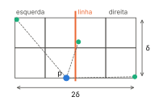
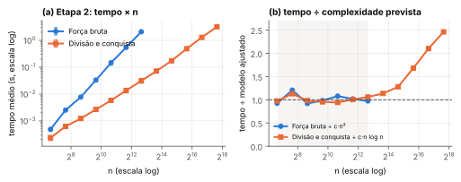
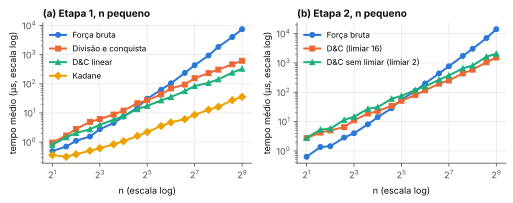

# Introdução

Este relatório descreve a implementação e a análise experimental de dois problemas resolvidos por divisão e conquista (D&C), cada um comparado com uma solução de força bruta: o subarranjo de soma máxima (Etapa 1) e o par de pontos mais próximos (Etapa 2). O código foi escrito em Python 3 usando apenas a biblioteca padrão. O repositório contém as implementações (`algoritmos/`), os programas que leem a entrada padrão (`etapa1.py`, `etapa2.py`), os arquivos de casos de teste e a bateria de testes (`testes/`), os scripts de medição e análise (`experimentos/`) e as medições brutas em CSV (`resultados/`). As instruções de execução estão no `README.md`.

# Etapa 1: subarranjo de soma máxima

## Algoritmos

A entrada é um vetor $a[1..n]$ de inteiros, $n \ge 1$; a saída é a maior soma de um subarranjo contíguo **não vazio** e seus índices de início e fim (base 1). Num vetor só de negativos a resposta é, portanto, o maior elemento. **Desempate:** entre intervalos de mesma soma vence o de menor início e, persistindo o empate, o de menor fim. Todas as versões seguem esse critério e devolvem exatamente a mesma resposta, o que permite compará-las diretamente nos testes.

- **Força bruta.** Para cada início $i$, estende o fim $j$ de $i$ até $n$ somando $a[j]$ à soma de $a[i..j-1]$; cada um dos $n(n+1)/2$ intervalos custa $O(1)$. Como só troca a resposta com soma estritamente maior, o primeiro intervalo ótimo encontrado já é o de menor $(i, j)$.
- **Divisão e conquista.** Divide $a[lo..hi]$ em $m = \lfloor (lo+hi)/2 \rfloor$, resolve as duas metades e calcula em $\Theta(n)$ o melhor subarranjo que cruza o meio: o melhor sufixo de $a[lo..m]$ somado ao melhor prefixo de $a[m+1..hi]$ (as duas partes são independentes). A resposta é a melhor das três. Para respeitar o desempate, o sufixo é varrido de $m$ para $lo$ atualizando com $\ge$ (fica o menor início) e o prefixo de $m+1$ para $hi$ atualizando com $>$ (fica o menor fim).
- **Versões $O(n)$ (questão desafio).** (i) *D&C linear:* cada chamada devolve também a soma total, o melhor prefixo e o melhor sufixo do trecho; o cruzamento passa a ser sufixo(esq) + prefixo(dir), obtido em $O(1)$, e prefixo e sufixo do trecho inteiro também saem em $O(1)$ (ex.: prefixo $= \max(\text{pref}_e,\ \text{total}_e + \text{pref}_d)$). (ii) *Kadane:* uma varredura que mantém a melhor soma terminando na posição atual e descarta o trecho corrente quando sua soma fica negativa (com soma zero ele é mantido, preservando o menor início).

## Recorrências

**Força bruta:** o laço interno executa $\sum_{i=1}^{n}(n-i+1) = n(n+1)/2$ vezes, logo $T(n) = \Theta(n^2)$.

**Divisão e conquista:** $T(1) = \Theta(1)$ e $T(n) = 2T(n/2) + \Theta(n)$. Com $a = b = 2$ e $f(n) = \Theta(n) = \Theta(n^{\log_b a})$, o caso 2 do Teorema Mestre dá $T(n) = \Theta(n \log n)$. Pela árvore de recursão: o nível $k$ tem $2^k$ subproblemas de tamanho $n/2^k$ que custam juntos $cn$; com $\log_2 n + 1$ níveis, $T(n) = cn\log_2 n + \Theta(n)$.

**D&C linear:** $T(n) = 2T(n/2) + \Theta(1)$. Como $f(n) = O(n^{1-\varepsilon})$, o caso 1 do Teorema Mestre dá $T(n) = \Theta(n)$ (a árvore tem $2n-1$ nós de custo constante). **Kadane:** $T(n) = T(n-1) + \Theta(1) = \Theta(n)$.

# Etapa 2: par de pontos mais próximos

## Algoritmo

A entrada são $n \ge 2$ pontos $(x, y)$; a saída é a menor distância e os índices $i < j$ do par (desempate pelo menor $(i, j)$). As distâncias são comparadas ao quadrado, o que é exato para coordenadas inteiras. A força bruta compara os $n(n-1)/2$ pares. A divisão e conquista:

1. **Pré-processamento** com a ordenação da biblioteca padrão (`sorted`): índices ordenados por $x$ ($P_x$) e por $y$ ($P_y$). Pontos coincidentes ficam adjacentes em $P_x$; se existirem, a resposta é 0 e o algoritmo termina. Isso garante $\delta > 0$ na recursão, hipótese do argumento da Seção 3.2.
2. **Dividir:** a linha vertical passa pela mediana das coordenadas $x$, isto é, pelo último ponto $\ell$ da metade esquerda de $P_x$. A pertinência ao lado esquerdo é decidida pela posição do ponto em $P_x$ (e não pelo valor de $x$), o que funciona mesmo quando muitos pontos têm o mesmo $x$; $P_y$ é dividido em $\Theta(n)$ preservando a ordem por $y$.
3. **Conquistar:** resolve cada lado; $\delta$ é a menor das duas distâncias.
4. **Combinar:** a faixa $S$ contém os pontos com $|x - x_\ell| \le \delta$, já ordenados por $y$; cada ponto é comparado com seus sucessores em $S$ enquanto a diferença em $y$ for $\le \delta$, **no máximo 7**.
5. **Limiar:** subproblemas com até $c$ pontos são resolvidos por força bruta ($c = {{num:limiar_padrao}}$, Seção 5.4).

## Por que bastam 7 comparações por ponto

Seja $p$ um ponto da faixa e $R = [x_\ell - \delta,\ x_\ell + \delta] \times [y_p,\ y_p + \delta]$ (Figura 1). Divida $R$ em 8 quadrados de lado $\delta/2$, quatro de cada lado da linha. Dois pontos do **mesmo lado** estão a distância $\ge \delta$, pois $\delta$ é a menor distância dentro de cada lado; mas dois pontos num mesmo quadrado estão a distância $\le \delta\sqrt{2}/2 < \delta$. Logo cada quadrado contém no máximo um ponto do seu lado (um ponto sobre a linha pertence ao lado indicado por sua posição em $P_x$), e $R$ contém no máximo 8 pontos, contando $p$. Todo ponto $q$ posterior a $p$ na ordem por $y$ com $y_q - y_p \le \delta$ está em $R$; portanto há no máximo 7 deles, e qualquer par $(p, q)$ cruzando a linha a distância $\le \delta$ é encontrado ao examinar os 7 sucessores de $p$. Como cada lado já foi resolvido, nenhum par a distância $< \delta$ escapa. A bateria de testes confirma o limite empiricamente: sem limitar a busca (examinando todos os sucessores com $\Delta y \le \delta$), nunca aparecem mais de 7 em grades, colunas densas, pontos em círculo e entradas aleatórias. O máximo observado foi {{num:faixa_max_sucessores_grade}} em grades $k \times k$ (o caso mais denso) e {{num:faixa_max_sucessores}} em entradas aleatórias com $n = 6400$: o limite 7 é folgado. Num controle negativo, limitar a busca a 1 sucessor produz respostas erradas.

{width=40%}

## Recorrência

Ordenações iniciais: $\Theta(n \log n)$. Recursão: $T(n) = \Theta(1)$ se $n \le c$ e $T(n) = 2T(n/2) + \Theta(n)$ caso contrário (dividir $P_y$, montar a faixa e fazer no máximo $7|S| \le 7n$ comparações). Pelo caso 2 do Teorema Mestre, $T(n) = \Theta(n \log n)$, e o total também é $\Theta(n \log n)$. A força bruta faz $n(n-1)/2$ comparações: $\Theta(n^2)$.

**Efeito do limiar.** Sejam $\alpha$ o custo de comparar um par na força bruta e $\beta$ o custo, por ponto, de dividir e combinar. Resolver $s$ pontos por força bruta custa $\alpha\, s(s-1)/2$; dividir uma vez e usar força bruta nas metades custa $2\alpha\,(s/2)(s/2-1)/2 + \beta s$. Dividir só compensa quando $\alpha s^2/4 > \beta s$, isto é, $s > 4\beta/\alpha$: o limiar ótimo é uma **constante** que não depende de $n$, definida pela razão entre os custos das duas operações na máquina e na linguagem usadas.

# Metodologia experimental

Máquina usada (arquivo `resultados/maquina.txt`):

{{maquina}}

Cada ponto das curvas é a média de **15 execuções** (20 no estudo do limiar), cada uma com uma entrada aleatória nova, gerada com semente registrada no CSV: inteiros uniformes em $[-100, 100]$ na Etapa 1 e pontos reais uniformes em $[0, 10^6]^2$ na Etapa 2. Em cada repetição todos os algoritmos recebem a mesma entrada, em ordem sorteada. O tempo é medido com `time.perf_counter_ns`, com o coletor de lixo desligado, e inclui todo o trabalho do algoritmo (na Etapa 2, também as ordenações), mas não a geração da entrada. Para $n \le 512$, cada medição repete a chamada até somar pelo menos 20 ms e divide o total pelo número de chamadas. Os tamanhos são 100, 200, 400, …, 6400; as versões rápidas foram medidas também até 204 800.

A máquina é virtual e apresentou flutuações de tempo entre execuções idênticas (coeficiente de variação médio de {{num:cv_medio_pct}}%, chegando a {{num:cv_max_pct}}%), atribuídas à interferência do hipervisor. Por isso as tabelas trazem o desvio padrão e as conclusões se apoiam na tendência ao longo de vários tamanhos, e não em pontos isolados. As medições brutas estão em `resultados/*_medicoes.csv` (uma linha por execução) e os resumos em `resultados/resumo_*.csv`.

# Resultados e discussão

## Etapa 1

A Tabela 1 mostra os tempos médios e, entre parênteses, a razão $T(n)/T(n/2)$. Para $\Theta(n^2)$ essa razão deve ser 4; para $\Theta(n\log n)$, $2(1 + 1/\log_2 n)$, em média {{num:razao_prevista_nlogn}} entre 100 e 6400; para $\Theta(n)$, 2.

{{tabela:etapa1}}

: **Tabela 1.** Etapa 1: tempo médio ± desvio padrão (ms) e razão $T(n)/T(n/2)$.

Entre 100 e 6400, a força bruta teve razão média {{num:etapa1_forca-bruta_razao_media}} e inclinação log-log de {{num:etapa1_forca-bruta_inclinacao}}, próxima de 2. A D&C teve razão média {{num:etapa1_dc_razao_media}} e inclinação {{num:etapa1_dc_inclinacao}}, compatível com $n\log n$, cuja inclinação local é $1 + 1/\ln n \approx 1{,}1$ nessa faixa. As versões lineares ficaram com inclinações {{num:etapa1_dc-linear_inclinacao}} (D&C linear) e {{num:etapa1_kadane_inclinacao}} (Kadane). Na Figura 2(b) as curvas normalizadas oscilam em torno de 1 sem tendência sistemática, com desvio máximo de {{num:etapa1_forca-bruta_erro_pct}}%, {{num:etapa1_dc_erro_pct}}%, {{num:etapa1_dc-linear_erro_pct}}% e {{num:etapa1_kadane_erro_pct}}%, da ordem do ruído da máquina; um modelo errado (por exemplo, $n^2$ para a D&C) apareceria como uma curva subindo ou descendo de forma contínua. O padrão se mantém até $n = 204\,800$; a curva da D&C desce levemente porque o tempo real é $a\,n\log_2 n + b\,n$ (o termo $b\,n$ vem das $n$ folhas da recursão) e o peso relativo de $b\,n$ cai como $1/\log n$. O comportamento observado confirma, portanto, as recorrências. Em $n = 6400$ a D&C é {{num:etapa1_speedup_6400}} vezes mais rápida que a força bruta.

As duas versões lineares têm a mesma complexidade, mas Kadane é {{num:etapa1_linear_sobre_kadane_6400}} vezes mais rápido que a D&C linear: a D&C faz $2n-1$ chamadas recursivas e cria uma tupla por chamada, enquanto Kadane executa uma iteração simples por elemento. Em Python uma chamada de função custa muito mais que uma iteração de laço, e a constante pesa tanto quanto a assintótica para uma comparação prática.

## Etapa 2

{{tabela:etapa2}}

: **Tabela 2.** Etapa 2: tempo médio ± desvio padrão (ms) e razão $T(n)/T(n/2)$; a D&C usa limiar 16.

Entre 100 e 6400, a força bruta teve razão média {{num:etapa2_forca-bruta_razao_media}} e inclinação {{num:etapa2_forca-bruta_inclinacao}}; a D&C, razão média {{num:etapa2_dc_razao_media}} e inclinação {{num:etapa2_dc_inclinacao}}. Nessa faixa as curvas normalizadas (Figura 3b) ficam em torno de 1 (desvio máximo de {{num:etapa2_forca-bruta_erro_pct}}% e {{num:etapa2_dc_erro_pct}}%), o que confirma $\Theta(n^2)$ e $\Theta(n\log n)$. Em $n = 6400$ a D&C é {{num:etapa2_speedup_6400}} vezes mais rápida. A Tabela 3 resume os ajustes das duas etapas.

{{tabela:ajustes}}

: **Tabela 3.** Inclinação da reta de mínimos quadrados em $\log T \times \log n$ e maior desvio relativo entre o tempo medido e o modelo $c\,f(n)$ ajustado.

**Desvio acima de $n \approx 10^4$.** Acima de 6400 a curva normalizada da D&C sobe: o tempo por $n\log_2 n$ passa de {{num:custo_nlogn_etapa2_6400_ns}} ns em $n = 6400$ para {{num:custo_nlogn_etapa2_204800_ns}} ns em $n = 204\,800$, e a inclinação no intervalo todo vai a {{num:etapa2_dc_inclinacao_todos}}. O algoritmo não passou a fazer mais operações: a instrumentação mostra que a forma da recursão é a mesma em todos os tamanhos (Tabela 4, exatamente $0{,}16\,n$ chamadas e um nível a mais a cada duplicação). O que muda é o custo de cada operação. A Etapa 2 acessa as coordenadas por índices em ordem de $y$, que é aleatória em relação à posição dos objetos na memória; quando o conjunto de trabalho deixa de caber na cache, cada acesso fica mais caro. Para testar a hipótese, medimos os mesmos pontos recriados em ordem crescente de $x$, de modo que pontos vizinhos no plano fiquem vizinhos na memória: o número de operações é idêntico, mas o custo em $n = 204\,800$ cai de {{num:loc_aleatoria_204800_ns}} para {{num:loc_ordem_x_204800_ns}} ns por $n\log_2 n$. Na Etapa 1, que percorre o vetor sequencialmente, o efeito não aparece ({{num:custo_nlogn_etapa1_6400_ns}} ns em 6400 e {{num:custo_nlogn_etapa1_204800_ns}} ns em 204 800). A análise assintótica supõe o modelo RAM, em que todo acesso à memória custa o mesmo; o desvio observado é um limite desse modelo, não do algoritmo.

{{tabela:localidade}}

: **Tabela 4.** D&C da Etapa 2 com os mesmos pontos em ordem aleatória e em ordem de $x$ (média de 10 execuções).

## Força bruta × divisão e conquista em entradas pequenas

A análise assintótica não diz quem vence em entradas pequenas: lá pesam as constantes. A Figura 4 mostra os tempos para $n$ de 2 a 512.

Na Etapa 1 a força bruta é mais rápida que a D&C até $n \approx$ {{num:cruzamento_etapa1_dc}}, a partir de onde a D&C vence sempre. A força bruta executa só uma soma e uma comparação por intervalo num laço apertado, enquanto a D&C paga, por elemento, uma chamada recursiva, a criação de tuplas e duas varreduras por nível; com $T_{fb} \approx a\,n^2/2$ e $T_{dc} \approx b\,n\log_2 n$ e $b \gg a$, o termo quadrático só domina depois de algumas dezenas de elementos. Kadane é mais rápido que a força bruta em todos os tamanhos medidos, por não ter sobrecarga de recursão; a D&C linear passa à frente em $n \approx$ {{num:cruzamento_etapa1_linear}}.

Na Etapa 2 a D&C sem limiar só passa à frente em $n \approx$ {{num:cruzamento_etapa2_dc2}}: além das chamadas recursivas, ela ordena os pontos duas vezes e cria listas novas ($P_y$ de cada lado e a faixa) em cada nível. Com o limiar 16 a D&C é idêntica à força bruta até 16 pontos (exceto pelas ordenações iniciais) e vence a força bruta a partir de $n \approx$ {{num:cruzamento_etapa2_dc}}. O ponto de cruzamento depende da linguagem e da máquina, mas sua existência não: para $n$ grande, $n^2$ supera $n \log n$ qualquer que seja a razão entre as constantes.

## Escolha do limiar na Etapa 2

O limiar $c$ foi variado de 2 a 128 com $n = 6400$ e $n = 50\,000$ (Tabela 5 e Figura 5). Limiares pequenos fazem a recursão descer até subproblemas em que dividir custa mais do que comparar todos os pares (limiar 2: {{num:limiar_pior_2_pct}}% mais lento que o melhor, na média geométrica dos dois tamanhos); limiares grandes deixam folhas em que a força bruta quadrática domina (limiar 128: {{num:limiar_pior_128_pct}}% mais lento).

{{tabela:limiar}}

: **Tabela 5.** Etapa 2: tempo da D&C (ms) para cada limiar $c$, média e mediana de 20 execuções.

Para justificar a escolha ajustamos às 40 médias o modelo $T(n, c) \approx K_n + \alpha P(c) + \beta W(c)$, em que $P(c)$ é o número exato de pares comparados nas folhas e $W(c)$ a soma dos tamanhos dos nós internos, ambos obtidos simulando a recursão. O ajuste deu $\alpha \approx$ {{num:limiar_alfa_ns}} ns por par e $\beta \approx$ {{num:limiar_beta_ns}} ns por ponto e nível. O $\alpha$ das folhas é maior que o custo por par da força bruta completa em $n = 6400$ ({{num:alfa_forca_bruta_ns}} ns), como esperado: nas folhas os pontos são acessados por uma lista de índices e os laços internos são curtos, então o custo fixo de cada laço se divide entre poucos pares. O limiar previsto pela Seção 3.3 é $4\beta/\alpha \approx$ {{num:limiar_previsto}}. Nas medições, o melhor tempo combinado foi obtido com $c =$ {{num:limiar_melhor_medido}}, mas a curva é plana entre {{num:limiar_regiao_plana}}: todos esses limiares ficaram a menos de 8% do melhor, e {{num:limiar_quase_otimos}} a menos de 3%. Diferenças dessa ordem estão no nível do ruído, pois o erro padrão típico de cada média é de {{num:limiar_erro_padrao_pct}}% (20 execuções numa máquina com flutuação de ~15%). **Escolhemos $c = 16$** porque (i) coincide com a previsão do modelo ajustado às próprias medições; (ii) está no centro da região de tempo mínimo, onde a curva é plana e uma pequena variação do custo relativo $\beta/\alpha$ entre máquinas não muda o resultado de forma apreciável; e (iii) ficou a {{num:limiar_padrao_pct}}% do melhor tempo medido. Em outra linguagem ou máquina a razão $\beta/\alpha$ muda e o limiar deve ser reajustado com o mesmo procedimento (`python3 experimentos/medir.py limiar`).

# Testes

A bateria de testes tem duas partes e é executada com `python3 -m unittest discover -s testes`. **(1) Casos documentados:** `testes/casos_etapa1.txt` ({{num:casos_etapa1}} casos) e `testes/casos_etapa2.txt` ({{num:casos_etapa2}} casos) trazem entrada, saída esperada e o motivo de cada caso. Na Etapa 1 cobrem os casos de borda pedidos (vetor de tamanho 1 com valor positivo, negativo e zero; só negativos, com o máximo no início, no meio, no fim e empatado; empates entre intervalos disjuntos, por extensão com zeros, entre as metades e entre as três candidatas da combinação), além de $n = 2$, resposta cruzando o meio ou inteira numa metade, $n$ ímpar, $n = 100$, somas que estouram 32 bits e entrada em formato livre. Na Etapa 2 cobrem $n = 2$ e $n = 3$, pontos coincidentes ($\delta = 0$), todos os pontos com o mesmo $x$ (a mediana não separa por valor) ou o mesmo $y$, par cruzando a linha ou inteiro num dos lados, empates entre esquerda, direita e faixa, grades e colunas densas, coordenadas negativas, reais, muito próximas e da ordem de $2\cdot10^9$. Cada caso é executado em todas as implementações (na Etapa 2, com limiares 2, 3, 4 e 16, com e sem o limite de 7 vizinhos) e no programa de linha de comando; as saídas esperadas são conferidas por um oráculo que aplica a definição do problema. **(2) Testes gerados:** milhares de entradas aleatórias com valores em faixas estreitas (para forçar empates e repetições) comparadas com o oráculo, todos os tamanhos de 1 a 70, vetores com $2^{16}+3$ elementos, invariância da distância a permutações e translações, o limite de 7 sucessores e entradas inválidas. Para verificar que a bateria detecta erros, introduzimos defeitos propositais (trocar $\ge$ por $>$ nos desempates, filtrar a faixa com $<$, dividir pelo valor de $x$, remover o tratamento de pontos coincidentes): todos foram detectados.

# Conclusão

As medições confirmaram as recorrências: a força bruta cresce com inclinação próxima de 2 nas duas etapas, a divisão e conquista com inclinação próxima de 1,1, como esperado para $n \log n$, e as versões lineares da Etapa 1 com inclinação próxima de 1. O único desvio, na Etapa 2 acima de $10^4$ pontos, foi explicado pela hierarquia de memória, que o modelo RAM da análise não considera. A força bruta vence apenas em entradas pequenas, onde a sobrecarga da recursão (chamadas de função, criação de listas e, na Etapa 2, ordenações) pesa mais que o número de operações; a partir de algumas dezenas de elementos a divisão e conquista vence, com vantagem de duas ordens de grandeza em $n = 6400$. Combinar as duas técnicas compensa: com força bruta abaixo de um limiar escolhido por um modelo de custo validado experimentalmente, a Etapa 2 ficou mais rápida que a recursão completa, que foi {{num:limiar_pior_2_pct}}% mais lenta.
